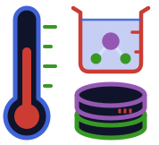

<p align="center">
  
</p>

<h1 align="center">ThermophysicalDB.jl</h1>

<p align="center">
  <strong>Experimental thermophysical data, one call away.</strong><br>
  Download the thermophysical databases once, keep it up to date, and filter, plot and analyse more than a hundred thousand measured systems from the Julia REPL.
</p>

<p align="center">

[](https://eduardo-bdmalves.github.io/ThermophysicalDB.jl/stable)
[](https://eduardo-bdmalves.github.io/ThermophysicalDB.jl/dev)
[](https://github.com/Eduardo-BDMAlves/ThermophysicalDB.jl/actions/workflows/Test.yml?query=branch%3Amain)
[](https://codecov.io/gh/Eduardo-BDMAlves/ThermophysicalDB.jl)
[](https://github.com/Eduardo-BDMAlves/ThermophysicalDB.jl/actions/workflows/Lint.yml?query=branch%3Amain)
[](https://github.com/Eduardo-BDMAlves/ThermophysicalDB.jl/actions/workflows/Docs.yml?query=branch%3Amain)
<!-- [](https://doi.org/FIXME) -->
[](CODE_OF_CONDUCT.md)
[](#contributors)
[](https://github.com/JuliaBesties/BestieTemplate.jl)

</p>

## What it is for

Experimental data on density, viscosity, thermal conductivity, vapor pressure, heat capacity and many other properties are scattered over thousands of articles. The idea is to gather several databases of experimental data and provide an interface for accessing and dealing with all data in a consistent manner. At this point ThermoML Archive of NIST/TRC, is the only database used. It gathers the experimental points in a standard format, but it is a collection of XML files, not something you can query. ThermophysicalDB.jl turns it into tables you can filter and compare, so that questions such as *how well does this equation of state reproduce the measured liquid density of hexane?* or *which publications agree on the density of water at 25 °C?* take a few lines.

- **One call gets everything.** `database()` downloads the archive, verifies its checksum, parses it once and keeps a binary cache. Later sessions only check for a newer version and load the cache.
- **Filter the way you think.** Select by compound, property, temperature and pressure range, author, DOI, year and more. Chain filters; each one only touches the rows that survived the previous one.
- **Units that mean something.** Limits accept [Unitful.jl](https://github.com/PainterQubits/Unitful.jl) quantities such as `25u"°C"` or `1u"atm"`, and tables can return Unitful columns.
- **Uncertainty on one footing.** Every expanded uncertainty is also restated at *k* = 2 by an explicit, documented rule, so points from different laboratories can be weighted somewhat consistently.
- **Tables.jl all the way.** A selection is a Tables.jl table made of plain vectors: plot it with Makie, hand it to a DataFrame, or write it to disk.
- **Two databases.** The experimental points (ThermoML) and the nomenclature and base properties of the compounds (names, CAS number, PubChem CID, SMILES, InChI, molar mass) are two separate databases, linked on demand. A compound can be named by any of them, and when a name is ambiguous the user chooses; the ThermoML data are never changed.
- **Cite what you use.** A selection exports its BibTeX file and a summary table of the articles behind it (LaTeX, Markdown or CSV).
- **Extensible.** The same schema is meant to hold other databases, including your own local data.

## Installation

ThermophysicalDB.jl requires Julia 1.13 or later. Until the package is registered in the General registry, install it from GitHub:

```julia
using Pkg
Pkg.add(url = "https://github.com/Eduardo-BDMAlves/ThermophysicalDB.jl")
```

## A first look

The first call to `database()` downloads and prepares the archive (a few minutes, once). After that, a selection is one line:

```julia
using ThermophysicalDB, Unitful

db = database()

# hexane thermal conductivity between 0 and 100 °C at about 1 atm
v = points(
    db; component = "hexane", exact = true, property = "Thermal conductivity",
    temperature = (0u"°C", 100u"°C"), pressure = (0.9u"atm", 1.1u"atm"),
)

t = table(v; quantities = Unitful)   # Tables.jl columns: temperature, pressure, value, unc_k2, doi, year, ...
```

The [documentation](https://eduardo-bdmalves.github.io/ThermophysicalDB.jl/dev) has a getting-started guide and tutorials that go from a plot of hexane conductivity to comparing the measured density of water with IAPWS-95, and hexane and CO₂ data with the equations of state of [Clapeyron.jl](https://github.com/ClapeyronThermo/Clapeyron.jl).

## Data source

ThermophysicalDB.jl reads the **ThermoML Archive**, the experimental thermophysical property database of the Thermodynamics Research Center (TRC) at NIST, built on the IUPAC ThermoML standard ([dataset DOI 10.18434/mds2-2422](https://doi.org/10.18434/mds2-2422)). The data are theirs and the authors' of the original articles; this package is an independent project that downloads, reads and filters them. The aim is to bring several experimental databases under one interface, starting with this one.

Data distributed through the *Journal of Chemical & Engineering Data*, *The Journal of Chemical Thermodynamics*, *Fluid Phase Equilibria*, *Thermochimica Acta* and *International Journal of Thermophysics* ThermoML Archives. NIST states that these files are available with permission of the journal publishers, so this package does not contain or redistribute any of them: it downloads the archive directly from NIST to your computer. It is an independent project, not affiliated with, sponsored or endorsed by NIST, TRC, IUPAC or the publishers, and it comes with no warranty. See [NOTICE.md](NOTICE.md) and the [About the data](docs/src/40-about-data.md) page for the terms, the citations and the notice that applies to modified data.
The data are provided by NIST "AS IS", without warranty and without liability; the full NIST disclaimer, the citation of the archive (Riccardi et al., 2022, and the dataset record) and the credit due to the original source of each point are in [NOTICE.md](NOTICE.md).

## How to Cite

If you use ThermophysicalDB.jl in your work, please cite using the reference given in [CITATION.cff](https://github.com/Eduardo-BDMAlves/ThermophysicalDB.jl/blob/main/CITATION.cff).

## Contributing

If you want to make contributions of any kind, please first that a look into our [contributing guide directly on GitHub](docs/src/90-contributing.md) or the [contributing page on the website](https://eduardo-bdmalves.github.io/ThermophysicalDB.jl/dev/90-contributing/)

---

### Contributors

<!-- ALL-CONTRIBUTORS-LIST:START - Do not remove or modify this section -->
<!-- prettier-ignore-start -->
<!-- markdownlint-disable -->
<table>
  <tbody>
    <tr>
      <td align="center" valign="top" width="14.28%"><a href="https://github.com/Eduardo-BDMAlves"><br /><sub><b>Eduardo Bader Dalfovo Mohr Alves</b></sub></a><br /><a href="https://github.com/Eduardo-BDMAlves/ThermophysicalDB.jl/commits?author=Eduardo-BDMAlves" title="Code">💻</a> <a href="https://github.com/Eduardo-BDMAlves/ThermophysicalDB.jl/commits?author=Eduardo-BDMAlves" title="Documentation">📖</a> <a href="https://github.com/Eduardo-BDMAlves/ThermophysicalDB.jl/commits?author=Eduardo-BDMAlves" title="Tests">⚠️</a> <a href="https://github.com/Eduardo-BDMAlves/ThermophysicalDB.jl/commits?author=Eduardo-BDMAlves" title="Design">🎨</a> <a href="https://github.com/Eduardo-BDMAlves/ThermophysicalDB.jl/commits?author=Eduardo-BDMAlves" title="Data">🔣</a> <a href="#ideas-Eduardo-BDMAlves" title="Ideas, Planning, & Feedback">🤔</a></td>
    </tr>
  </tbody>
</table>

<!-- markdownlint-restore -->
<!-- prettier-ignore-end -->

<!-- ALL-CONTRIBUTORS-LIST:END -->
