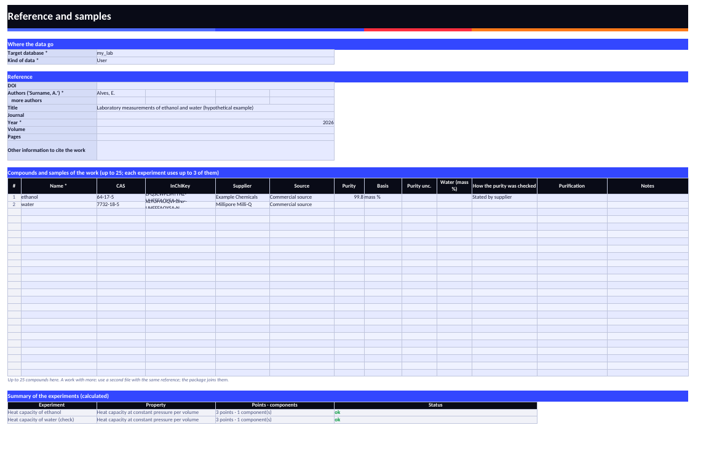
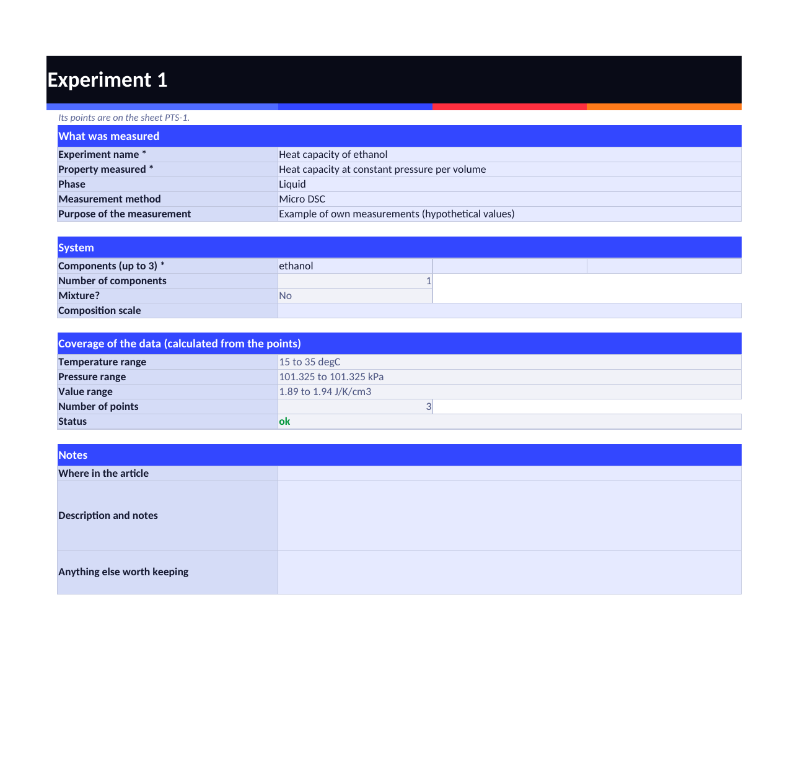
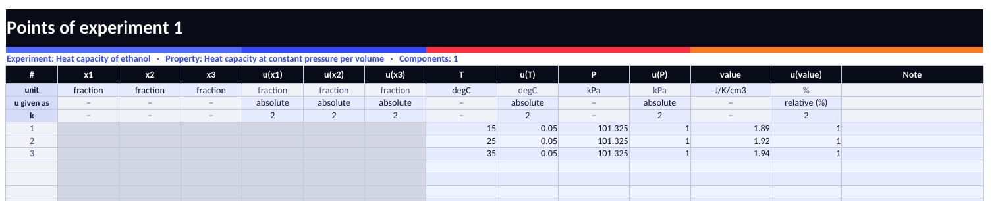

```@meta
CurrentModule = ThermophysicalDB
```

# [Dealing with your own data and db](@id tutorial_own_data)

The NIST archive is read-only: you never change it. Points from an article that is not in it, and the points you measured yourself, go into **databases of your own**, which are searched together with the archive as if they were one (see [Several databases that look like one](@ref updates)). This tutorial follows an experimentalist from the first idea to the published article, and uses every tool of the package for that:

1. **Looking for a gap** in what the literature already has, to decide what to measure.
2. **Creating databases** of your own, and adding data to them in two ways: by code, with the objects of the package ([`ReferenceRef`](@ref), [`ExperimentRef`](@ref) and the points), and with an **Excel spreadsheet** that the package writes, you fill in and it reads back.
3. **Editing** what you typed wrongly, and **naming** the experiments, so that months of measurements can be sorted into the articles they will become.
4. **Tables and figures for the paper**: the references table, the points and a figure in which only your data of that article are "This work", even when the database holds more.
5. **Publishing**: when the article is out, its points move to the literature with the right reference, and the rest of your notebook stays.

Two filled spreadsheets are ready to download: [`example-literature.xlsx`](https://github.com/Eduardo-BDMAlves/ThermophysicalDB.jl/raw/main/docs/src/assets/example-literature.xlsx) and [`example-own-measurements.xlsx`](https://github.com/Eduardo-BDMAlves/ThermophysicalDB.jl/raw/main/docs/src/assets/example-own-measurements.xlsx). All the numbers of the tutorial are invented to show the mechanics: they come from no article and no laboratory.

```@setup own
Main.DocsSetup.activate!()
```

## Two kinds of database

A database of your own has a *kind* that says what it holds:

| Kind | For | Priority when the same point is in two databases |
| :-- | :-- | :-- |
| `:literature` | points taken from published work that the archive lacks | lower |
| `:user` (default) | your own measurements | higher |

The kind is not decoration: it travels with every point, so later you can ask for the literature only, or for your own bench against everything else.

```@example own
using ThermophysicalDB

# `database()` returns one object that every page of a session shares, so this tutorial works on a
# private database that holds the same archive and nothing else: the databases it adds stay here.
archive = first(m for m in members(database()) if m.kind === :thermoml)
db = ThermophysicalDB.Database([archive])
root = mktempdir()   # the databases of this tutorial live in a temporary folder

add_database!(db, "papers"; kind = :literature, dir = root)
add_database!(db, "my_lab"; dir = root)   # kind = :user is the default
members(db)
```

## Looking for a gap in the literature

A measurement is worth the most where nobody has measured. Before the first sample is prepared, ask the archive what exists. The story of this tutorial is the **mass density of liquid ethanol**, ``\rho = m/V``, and the question is at which temperatures and pressures it has been measured. [`plot_xpt`](@ref) draws the plane of temperature and pressure of a selection, and `color = :count` colours each cell by the number of points in it, so the empty cells are the conditions that nobody has covered:

```@example own
using CairoMakie

survey = points(db; component = "ethanol", pure = true, property = "Mass density")
plot_xpt(survey; color = :count, backend = :makie, size = (760, 460))
```

A liquid is almost incompressible, and the density is the quantity that shows it: ``\kappa_T = \rho^{-1} (\partial\rho/\partial P)_T`` is of the order of 10⁻⁹ Pa⁻¹ for ethanol, so 50 MPa (500 bar) packs the molecules about 5 % closer. Most of the points are near atmospheric pressure, where the instruments are simple, and the high pressures, the corners with no points, are where a new bench can add something. The same survey of the *sources*, in a table, says who is there: `reference_summary(survey)` lists the articles of the selection (see [Tables for a paper: exporting points and references](@ref tutorial_export)).

This tutorial's bench chooses an isotherm at 303.15 K from atmospheric pressure to 50 MPa, and one at 323.15 K. The volumetric heat capacity (see below) is measured on a second bench.

## A point from the literature, step by step

Take a hypothetical article that measured the **volumetric heat capacity at constant pressure**, ``c_p^V = \rho\, c_p`` in J K⁻¹ cm⁻³, of ethanol + water mixtures at 101.325 kPa. It is the heat that one cubic centimetre of the liquid absorbs per kelvin, and it is what a calorimeter that fills a cell of fixed volume (such as a micro DSC) measures directly: the cell holds a volume, not a mass, so the quantity is ``C_p / V`` and no density is needed. To get the specific heat capacity ``c_p`` (J K⁻¹ kg⁻¹) you divide by the density of the same sample at the same ``T`` and ``P``, which is why the two properties are different entries in ThermoML. The composition is a **mass fraction**, ``w_i = m_i / m_{\text{total}}``: it is what you get by weighing the components, and it does not depend on temperature.

All the numbers of this tutorial are invented to show the mechanics: they come from no article and no laboratory.

### 1. The reference

The reference is the work the points come from. [`add_reference!`](@ref) returns a [`ReferenceRef`](@ref), a small handle that the next step needs:

```@example own
ref = add_reference!(
    db;
    database = "papers",
    doi = "10.5555/example.2026.001",
    title = "Volumetric heat capacity of ethanol + water mixtures (hypothetical example)",
    journal = "Journal of Hypothetical Data",
    year = 2026,
    volume = "12",
    pages = "100-108",
    authors = ["Silva, A.", "Souza, B."],
)
```

### 2. The experiment

An experiment is one *system*: a list of components and the scale in which their amounts are given. Components are recognised by name, CAS number or InChIKey, through the compound database of the package, so that `"water"` here is the same compound as `"water"` in the archive and the two sets of points meet in one search:

```@example own
experiment = add_experiment!(
    ref;
    components = ["water", "ethanol"],
    composition_scale = :mass_fraction,
    purpose = "Heat capacity of ethanol + water",
)
```

`composition` lists one amount for each component, in the order of `components`, and `NaN` for the ones you do not give. Here the article gives the mass fraction of ethanol, the *second* component, and the first follows from ``w_1 = 1 - w_2``; so the entry for water is `NaN`. In general a system of ``N`` components has ``N - 1`` free amounts.

### 3. The points

[`add_measurement!`](@ref) adds one point. Temperature and pressure may be text with a unit or plain numbers (K and kPa). Every uncertainty states its **coverage factor** ``k``, which says how it was obtained: a standard uncertainty is ``k = 1`` (about 68 % of the values for a normal distribution) and ``k = 2`` gives about 95 %. Without it, two sources that both say "1 %" cannot be compared.

The article also states the uncertainty of the *conditions*, which matters because the heat capacity depends on them: ``u(T)``, ``u(P)`` and ``u(w)`` go in `unc_temperature`, `unc_pressure` and `unc_composition`. A plain number is a standard uncertainty; [`UncertaintyTerm`](@ref) states the coverage, and a text such as `"0.02 degC"` is a difference. Here all are expanded uncertainties with ``k = 2``:

```@example own
for (w, temperature, c) in (
    (0.2, "15 degC", 3.99),
    (0.2, "25 degC", 4.02),
    (0.4, "15 degC", 3.58),
    (0.4, "25 degC", 3.62),
)
    add_measurement!(
        experiment;
        property = "Heat capacity at constant pressure per volume",
        unit = "J/K/cm3",
        value = c,
        unc = 0.015 * c,                                        # 1.5 % of the value
        unc_k = 2,
        temperature,
        pressure = "101.325 kPa",
        composition = [NaN, w],
        unc_temperature = UncertaintyTerm("0.02 degC"; k = 2),
        unc_pressure = UncertaintyTerm(0.5; k = 2),             # kPa
        unc_composition = [NaN, UncertaintyTerm(0.0005; k = 2)],
        phase = "Liquid",
        method = "Differential scanning calorimetry",
    )
end
```

The unit is converted once, when the point is added: the database keeps the property in J K⁻¹ m⁻³ (the unit of ThermoML), so 3.99 J K⁻¹ cm⁻³ is stored as 3.99 × 10⁶ J K⁻¹ m⁻³. The points are already in the joined view, with the name of the database as a column:

```@example own
literature = points(db; source = "papers")
table(literature)
```

`source` is the name of the database that holds the reference. If you also give a `component` (or a property or limits) that the database does not have, the answer is that the source exists but nothing in it matches, not that the source is unknown.

The uncertainties of the conditions are in the uncertainty table, one row per term, with the coverage and how each was obtained (given, or derived: the combined standard uncertainty is ``u = U/k``):

```@example own
uncertainty_table(only(parts(literature)))
```

### The same, in one call

When you have the whole article at hand, [`add_reference_data!`](@ref) takes it in one piece. Everything is checked *before* anything is added, so a mistake in the fifth experiment leaves the database as it was, and `dry_run = true` does only the check:

```julia
add_reference_data!(
    db;
    database = "papers",
    reference = (doi = "10.5555/example.2026.002", authors = ["Lima, C."], year = 2026),
    experiments = [
        (
            components = ["water", "ethanol"],
            composition_scale = :mass_fraction,
            property = "Heat capacity at constant pressure per volume", unit = "J/K/cm3",
            temperature = [288.15, 298.15], pressure = 101.325,
            x2 = [0.3, 0.3], value = [3.78, 3.81],
            unc_temperature = 0.01, unc_x2 = "0.1 %",
        ),
    ],
)
```

A column is a vector with one entry per point or a single value repeated; the first form above is the same thing written point by point.

### A percentage of a temperature

An uncertainty can be written as a percentage of the value, `"0.01 %"`. For a temperature that needs a rule, because the zero of °C and °F is not the absolute zero: 1 % of 25 °C is 0.25 K, but 1 % of 298.15 K is 2.98 K. The package always takes the percentage of the temperature in the **absolute** scale (K, or °R for °F, which is the same fraction), whatever unit you wrote the temperature in:

```@example own
e = add_experiment!(ref; components = ["ethanol"])
add_measurement!(e; property = "Heat capacity at constant pressure per volume", unit = "J/K/cm3",
                 value = 1.92, temperature = "25 degC", unc_temperature = "0.01 %")
pure = only(parts(points(db; source = "papers", component = "ethanol", exact = true)))
uncertainty_table(pure)
```

That is 0.01 % of 298.15 K, 0.0298 K, and not 0.01 % of 25 K. An absolute uncertainty with a unit is a difference instead, so `"0.05 degC"` is 0.05 K and `"0.09 degF"` is 0.05 K. The rule is part of the uncertainty documentation: [A percentage of a temperature is taken of the absolute scale](@ref).

## Your own measurements, by code

The densimeter, a vibrating-tube instrument, measures the **period** of oscillation of a tube filled with the sample, which depends on the mass in it and so on the density. The bench data go into the `my_lab` database. The difference to the literature is in what you know about them: you know how the sample was made and what the instrument can do, so you can state the uncertainty yourself. A notebook (a reference without a DOI) holds the work, and each isotherm is an experiment of the pure ethanol:

```@example own
notebook = add_reference!(
    db;
    database = "my_lab",
    title = "Laboratory notebook of the densimeter, 2026 (example)",
    year = 2026,
    authors = ["Alves, E."],
)

isotherm_303 = add_experiment!(notebook; components = ["ethanol"])

for (P, ρ) in ((101.325, 780.9), (10_000.0, 791.6), (30_000.0, 808.9), (50_000.0, 824.5))
    add_measurement!(
        isotherm_303;
        property = "Mass density",
        unit = "kg/m3",
        value = ρ,
        temperature = 303.15,
        pressure = P,                                       # kPa
        unc = "0.05 %",                                     # of the value, in the unit of the value
        unc_k = 2,
        unc_temperature = UncertaintyTerm(0.02; k = 2),     # K
        unc_pressure = UncertaintyTerm(50.0; k = 2),        # kPa
        phase = "Liquid",
        method = "Vibrating tube densimeter",
    )
end

table(points(db; source = "my_lab"))
```

The values are hypothetical. The density grows with pressure, as ``\kappa_T`` says, and the growth slows down: the same step of 20 MPa adds less at 50 MPa than at 10 MPa because the liquid is already more compact. A decrease with pressure would deserve a second look at what you typed.

Weeks later the second isotherm is measured. It is another experiment of the same notebook. An experiment that you add has a **name**, so it can be found again: `<database>_yyyy_mm_dd_HH:MM`, followed by `_<name of the compound>` when the system is a pure substance, unless you give one with `name`:

```@example own
isotherm_323 = add_experiment!(notebook; components = ["ethanol"], name = "dens-323")

for (P, ρ) in ((101.325, 763.4), (10_000.0, 775.2), (30_000.0, 794.9), (50_000.0, 811.8))
    add_measurement!(
        isotherm_323;
        property = "Mass density",
        unit = "kg/m3",
        value = ρ,
        temperature = 323.15,
        pressure = P,
        unc = "0.05 %",
        unc_k = 2,
        unc_temperature = UncertaintyTerm(0.02; k = 2),
        unc_pressure = UncertaintyTerm(50.0; k = 2),
        phase = "Liquid",
        method = "Vibrating tube densimeter",
    )
end

experiment_names(points(db; source = "my_lab"))   # the names of each point's experiment
```

### Editing what you typed

A mistake that is noticed later does not mean starting again. [`update_points!`](@ref) changes columns of a selection (a number, a vector, or a function of the current value): the densimeter was recalibrated with water, which says that every density is 0.04 % higher than it was written. [`remove_points!`](@ref) removes a selection, and like [`move_reference!`](@ref) and [`publish!`](@ref) it only says what would go unless `confirm = true`: the pump was unstable at one point of the 323.15 K isotherm.

```@example own
density = points(db; source = "my_lab", property = "Mass density")
update_points!(db, density; value = v -> v * 1.0004, on_conflict = :error)

unstable = points(db; source = "my_lab", temperature = (322.0, 324.0), pressure = (29_000.0, 31_000.0))
remove_points!(db, unstable; confirm = true)
length(points(db; source = "my_lab"))
```

The changes are in memory, and each one is written in the audit log of the database when it is saved. Whole articles go with [`remove_reference!`](@ref).

### Saving

Everything so far is in memory. [`save_database`](@ref) writes a database of your own to its folder, and it is read again, with no download, the next time you call [`database`](@ref) with the same folders:

```@example own
save_database(db, "my_lab")
```

## Your own measurements, with a spreadsheet

Typing points one by one is fine for ten points and tedious for ten thousand. A second bench, a micro DSC that measures the **volumetric heat capacity** (the heat that one cubic centimetre of liquid absorbs per kelvin, ``c_p^V = \rho\, c_p``), writes its results in Excel. The same steps as above, with an Excel file instead of code, come with the extension that loads when you load `XLSX`:

```@example own
using XLSX   # loading it activates the spreadsheet functions

template = joinpath(root, "template.xlsx")
export_template(db, template; experiments = 2)
isfile(template)
```

The file has these sheets:

| Sheet | What you fill in |
| :-- | :-- |
| `Guide` | nothing: it explains the colours and lists your databases and the properties you can use |
| `Reference` | the target database, its kind (Literature or User), the DOI, the authors, the title and the compounds |
| `EXP-1`, `EXP-2`... | one experiment each: name, property, phase, method, components, composition scale, and below it the **units** and the **uncertainty type** (absolute or relative in %) of each column |
| `PTS-1`, `PTS-2`... | the points of the experiment: the amounts, `T`, `P`, the value and the uncertainty of each (`u(x)`, `u(T)`, `u(P)`, `u(value)`), one point per row (up to 200). Under each header, `u given as` chooses *absolute* or *relative (%)* and `k` is the coverage factor of that column |

The three kinds of sheet, as the filled example [`example-own-measurements.xlsx`](https://github.com/Eduardo-BDMAlves/ThermophysicalDB.jl/raw/main/docs/src/assets/example-own-measurements.xlsx) shows them. In `Reference` the target database (`my_lab`), its kind (User), the work (here a notebook, with no DOI) and the compounds with their samples:



In each `EXP-n` sheet, the experiment: what was measured, the system and, calculated by the template, the coverage of its points:



And in `PTS-n` the points, one per row, with the unit, how the uncertainty is given (absolute or relative) and the coverage factor of each column. The temperature of this bench is in °C and the uncertainty of the value is relative, in %:



(The pictures are the example file drawn by LibreOffice; Excel shows the same cells.)

Only the input cells (the colours are explained in the `Guide`) are for you; the rest is protected. Property, method, phase, sample source, supplier, purity analysis, purification, units and scale are menus: the values that your databases already use come first (most used first), followed by generic choices, so a new point most likely joins what is already there. Method and supplier also accept your own text. Open `template.xlsx`, fill it in and save, or start from one of the examples:

- [`example-literature.xlsx`](https://github.com/Eduardo-BDMAlves/ThermophysicalDB.jl/raw/main/docs/src/assets/example-literature.xlsx): the hypothetical article above plus a pure-water experiment (nine points), target `literature`, temperatures in K with `u(T)`, `u(P)` and `u(w)` as expanded uncertainties (``k = 2``).
- [`example-own-measurements.xlsx`](https://github.com/Eduardo-BDMAlves/ThermophysicalDB.jl/raw/main/docs/src/assets/example-own-measurements.xlsx): the volumetric heat capacity of ethanol and of water (a check of the instrument), temperatures in °C (six points), target `my_lab`. The ethanol sheet gives `u(T)` in °C, which is a difference; the water sheet gives `u(T)` and `u(P)` as relative (`%`), which the package takes of the value in K and kPa.

### Check before importing

[`import_template`](@ref) with `only_check = true` reads the file and reports every problem, with the cell it is in, **without adding anything**, not even the database named in the file. A file with a wrong date, an unknown unit and a missing component gives all three at once, not one per attempt. The report also says whether the data could be written as a valid ThermoML file and, when they cannot, which criteria fail (the criteria are in the tables at the end of this page):

```@example own
example = pkgdir(ThermophysicalDB, "docs", "src", "assets", "example-literature.xlsx")

report = import_template(db, example; only_check = true)
(
    ok = report.ok,
    imported = report.imported,
    points = report.points,
    problems = report.problems,
    thermoml_compatible = report.thermoml_compatible,
    thermoml_failures = report.thermoml_failures,
)
```

`ok = true` means that the file can be imported, not that it was: `imported` is `false` here, and `points(db; source = "literature")` would still say that no such database exists.

### Import

When the report is clean, the same call without `only_check` adds the points, and its result has the same `thermoml_compatible` and `thermoml_failures`, with `imported = true`. The database comes from the sheet `Reference` (it is created if it does not exist yet), and the second file goes into a different one, so a single call can also take several files:

```@example own
result = import_template(db, example; warn_duplicates = false)
result.points
```

```@example own
own = pkgdir(ThermophysicalDB, "docs", "src", "assets", "example-own-measurements.xlsx")
import_template(db, own; warn_duplicates = false).points
```

```@example own
points(db; source = "my_lab")
```

### Repeated points

The example file describes the very article that was typed in by hand at the start, so those points are now in two databases, `papers` and `literature`. Nothing is removed or changed when this happens: [`duplicates`](@ref) lists the pairs, [`conflicts`](@ref) those that disagree beyond their uncertainties, and a selection keeps one copy of each by default (`duplicate = true` shows them all). Importing the same file again does the same: the points enter the database, and the later copy is left out of the selections.

```@example own
duplicates(db)
```

A few things the template accepts and checks:

- the composition scales *Mole fraction*, *Mass fraction*, *Molality* and *Amount concentration*, and the unit chosen for the amounts must belong to the scale (mol/kg for a molality, not mol/L);
- a **relative** uncertainty (%) is turned into an absolute one with the value of each point, and the coverage factor goes with it; for `u(T)` the percentage is taken of the temperature in K (also when the column is in °C or °F), see [A percentage of a temperature is taken of the absolute scale](@ref);
- an **absolute** `u(T)` or `u(P)` is a difference in the unit of its column (0.05 degC is 0.05 K), and an absolute `u(x)` is in the unit of the amounts;
- several files of the same work (the same DOI, or the same first author and year) are joined into one reference: the compounds are matched by name and the experiments are put one after the other.

!!! warning "Not stored yet"
    The note column, the sample data of the `Reference` sheet (purity, supplier...) and the "where in the article" fields are read but **not stored yet**. The import says so with a warning and in `result.ignored`; nothing is lost silently.

## Naming the experiments

Months pass, and the database fills with experiments of both benches, some for the first article, some for the second, some for no article yet. What separates them is **names**. Every experiment has at least one (see above), and you can add more with [`add_name!`](@ref) to the experiments of any selection; a name that several experiments share is the name of a group, and an experiment can have several names, so a group never takes away the name of another:

```@example own
density = points(db; source = "my_lab", property = "Mass density")
add_name!(density, "density-isotherms")

heat_capacity = points(db; source = "my_lab", property = "Heat capacity at constant pressure per volume")
add_name!(heat_capacity, "cp-micro-dsc")

experiment_names(points(db; source = "my_lab"))
```

The names are a filter of [`points`](@ref) (`experiment = "name"`, a `Regex`, or a vector of names), they are kept in the database and they go with the experiment if it moves to another database:

```@example own
table(points(db; experiment = "density-isotherms"))
```

A name can be changed with [`modify_name!`](@ref): on the database, in every experiment that has it (the publications that cite it follow it, see below), or on a selection, only there. [`remove_name!`](@ref) takes one, several (a vector) or all (`true`) away from a selection. As with [`remove_points!`](@ref), nothing happens without `confirm = true`, and the result says what would change:

```@example own
modify_name!(db, "cp-micro-dsc", "cp-bench-b")                    # what would change
modify_name!(db, "cp-micro-dsc", "cp-bench-b"; confirm = true)
add_name!(points(db; experiment = "cp-bench-b"), "check")          # a second name
remove_name!(points(db; experiment = "check"), "check"; confirm = true)
experiment_names(points(db; experiment = "cp-bench-b"))
```

The same works for the experiments that come from the ThermoML archive (`add_name!` on a selection of the archive), which is how you can label "the ones I compare with": the archive itself is not changed, the names are kept in a file next to it. The name is also the way to point at points that you have not measured yet; it is given when the experiment is added:

```@example own
later = add_experiment!(
    add_reference!(db; database = "my_lab", title = "Laboratory notebook, autumn (example)", year = 2026),
    components = ["ethanol"],
    name = "dens-313-extra",
)
add_measurement!(
    later;
    property = "Mass density",
    unit = "kg/m3",
    value = 771.8,
    temperature = 313.15,
    pressure = 20_000.0,
    unc = "0.05 %",
    unc_k = 2,
    method = "Vibrating tube densimeter",
)
length(points(db; source = "my_lab"))
```

The database now holds more than any one article will use: that point at 313.15 K belongs to no article yet.

## Calling your data "This work"

Next to the literature, the points of your bench should not look like one more article, but only the points of the article you are writing. A [`Publication`](@ref) describes an article and, with `name` and `experiments`, which experiments (by name) are its data. Two articles are being written at the same time, and each takes its own:

```@example own
add_publication!(
    db,
    Publication(;
        name = "paper-A",
        title = "Density of ethanol up to 50 MPa (example)",
        authors = ["Alves, E."],
        year = 2026,
        experiments = ["density-isotherms"],
    ),
)
add_publication!(
    db,
    Publication(;
        name = "paper-B",
        title = "Heat capacity of ethanol by micro DSC (example)",
        authors = ["Alves, E."],
        year = 2026,
        experiments = ["cp-bench-b"],
    ),
)
publications(db)
```

A publication refers to **names**, not to points: it is not changed by measuring more, by adding a name or by renaming one (a name that a publication uses cannot be lost). `this_work = "paper-A"` in [`table`](@ref), in the figures and in the exports says which points are "This work" in that output. The points of your databases that are not in it are "Own data", and the literature is "Literature":

```@example own
mine = points(db; source = "my_lab", property = "Mass density")
t = table(mine; this_work = "paper-A")
unique(zip(t.work, t.temperature, t.pressure))
```

The point at 313.15 K is in the selection and in the database, and it is "Own data": it is not in paper A. A selection of points can also be given as `this_work`, when a name is more than you need.

### A figure of paper A

The same holds for the figures: your points of the article are one group of their own, in the highlight colour and marker of the style, drawn on top of the literature, with the label of the publication in the legend. The literature keeps the groups of `marker_by` (the article, by default):

```@example own
density_all = points(db; component = "ethanol", pure = true, property = "Mass density")
plot_isotherms(density_all; this_work = "paper-A", backend = :makie, size = (760, 460))
```

The point at 313.15 K is in the figure, because it is in the selection, but it is not a star: it is not in paper A, so it is one more point of the others (the group is named by its year, the notebook having no DOI). The plane of the first figure can be drawn again, now with the conditions that paper A added (the cells that were empty have stars):

```@example own
plot_xpt(density_all; this_work = "paper-A", backend = :makie, size = (760, 460))
```

`marker_by = :work` puts all the literature together as well, which is often what a validation of a new bench needs, one group against the other.

### The tables and the references of the paper

The same selection exports as it is shown, and the publication says how your data are referred to. A paper that contains its own data does not cite itself: by default the `reference` column says "This work" and the `.bib` has no entry for it, and the references table has the articles of the *others* that are in the selection. With `cite = :unpublished` the data get the key of an `@unpublished` entry (title, authors, year and note of the publication), for a report or for a paper that cites your work in preparation, and `cite = :published` the key of the article of the DOI, once it is out. `cite` is kept in the `Publication` and every export can choose again:

| `cite` | The `reference` column and the references table | The `.bib` | For |
| :-- | :-- | :-- | :-- |
| `:label` (default) | "This work" | no entry | the paper that publishes the data: it does not cite itself |
| `:unpublished` | the key of an `@unpublished` entry | that entry | an internal report, or a paper that cites your unpublished work |
| `:published` | the key of the article of the DOI | the entry of the DOI, from the resolver and completed with the fields of the publication | once the paper is out (needs `doi`) |

```@example own
comparison = points(db; component = "ethanol", pure = true, property = "Mass density")
out = mktempdir()

export_points(joinpath(out, "paper_A"), comparison; this_work = "paper-A", formats = (:csv, :tex))
write_references(joinpath(out, "paper_A_refs"), comparison; this_work = "paper-A", online = false, cache = false, progress = false)
sort(readdir(out))
```

A selection of several databases is written as one list: the points of each database one after the other in the same file (the header once), the articles of all of them in one `.bib` (an article that two databases hold, with the same DOI, is one entry with one key), and one row of the references table for each property of your data. The ThermoML formats are for one database: export each part of `parts(view)`. The file has what the selection has: the point at 313.15 K is in the first export, as "Own data", and the selection by name leaves it out:

```@example own
only_a = points(db; experiment = "density-isotherms")
export_points(joinpath(out, "paper_A_only"), only_a; this_work = "paper-A", formats = (:csv,))
```

## When the article is published

The databases never mix: your data stay in `my_lab`, the literature in its own database, and the ThermoML archive is read only. What crosses is what you decide to move, and for it the package has two functions, both of which only say what they would do until `confirm = true`:

- [`move_experiments!`](@ref) moves the experiments that a name or a selection says to another database of yours, and [`move_reference!`](@ref) a whole reference. When only some points of an experiment are selected, those are copied and the others stay. The names go with the experiments.
- [`publish!`](@ref) is the flow for the points of one article once it has a DOI: they become the reference of that article (title, authors, journal, year and pages from the DOI, completed with the publication), in a database of literature, and the publication ends. The rest of your notebook, here the 313.15 K point, the check of the instrument you did not publish and paper B, stays where it is.

Paper A is out. First, what would happen, then do it:

```@example own
add_database!(db, "papers_lit"; kind = :literature, dir = root)   # the destination, a database of literature

plan = publish!(db, "paper-A"; doi = "10.5555/example.2026.100", to = "papers_lit", online = false)
(plan.published, plan.points, plan.experiments, plan.references)
```

```@example own
publish!(db, "paper-A"; doi = "10.5555/example.2026.100", to = "papers_lit", online = false, confirm = true)
length(points(db; source = "papers_lit")), length(points(db; source = "my_lab"))
```

The points are now literature (and the reference of the article has its DOI), found by the name they kept; paper B and the point at 313.15 K are still in `my_lab`, and the figures and tables of paper B still know what is "This work":

```@example own
points(db; experiment = "density-isotherms")
publications(db)
```

`publish!(db; doi = ...)` with no name publishes all the data of your databases, the publication of [`set_publication!`](@ref), for the case in which everything you measured is one article. `publish!(db, selection; doi = ...)` takes any selection of points. In memory until [`save_database`](@ref), which writes the audit log of the move in both databases.

## What a reference needs

There are two levels, and they are different questions. The first is what the **package** needs to store a reference: when something here is missing the import refuses and lists the cell, and nothing is added. The second is what **ThermoML** needs to write the same data as a valid ThermoML file: the package stores the data anyway, and the report lists what fails in `thermoml_failures`, so you can fix it now or later. Both apply to the spreadsheet and to the functions (`add_reference!`, `add_experiment!`, `add_measurement!`, `add_reference_data!`).

### Required to add a reference to a database

| Item | Where in the sheet | Rule |
| :-- | :-- | :-- |
| Database | `Reference!C5` (or `database = ...`) | A name that starts with a letter or a digit and has letters, digits, `_`, `.`, `-` or a space; it is created if it does not exist; `thermoml` is the archive's. |
| Kind of data | `Reference!C6` | `Literature` or `User`; it must be the kind of a database that already exists. |
| Identification of the work | `Reference!C9:C12` | The DOI, or the authors, or the title (at least one). |
| Year | `Reference!C14` | Required when there is no DOI; a whole number between 1500 and 2200. |
| Experiments | `EXP-n`, `PTS-n` | At least one experiment with at least one point; each has a name (`EXP-n!C5`) and the property (`C6`). |
| Components | `EXP-n!C12:E12` | From 1 to 3, filled from the first cell on, each one listed in the compounds of the `Reference` sheet (once) and identified by InChIKey, CAS number or exact name in the compound database. |
| Composition scale | `EXP-n!C15` | Needed for a mixture: mole fraction, mass fraction, molality or amount concentration; the unit of the amounts has to belong to the scale (mol/kg for a molality, not mol/L). |
| Value of each point | `PTS-n`, `value` | A finite number, in the unit of its column; a relative uncertainty needs it as a number. |
| Temperature and pressure | `PTS-n`, `T`, `P` | Optional; if given, ``T > 0`` K and an absolute ``P \ge 0`` (a gauge pressure is refused). |
| Uncertainties | `PTS-n`, `u(...)` | Optional; if given, a number that is not negative, with its `k` (row 7) as a number greater than zero. |

### Required by ThermoML (reported in `thermoml_failures`)

| Criterion | Rule | Why |
| :-- | :-- | :-- |
| Citation | The DOI, or the authors, the title and the year | The ThermoML citation has to identify the work; the file of an article is named by its DOI. |
| Property | A name in the ThermoML list (as the archive writes it; the sheet `Properties` shows them) | The schema accepts only the names of its list, each with its unit; the package converts the unit. |
| Phase | One of the ThermoML phases (`Liquid`, `Gas`, `Crystal`, `Glass`, `Solution`, `Ideal gas`...) or empty | The schema enumerates the phases. |
| Composition of a mixture | In every point, the ``N - 1`` amounts of a system of ``N`` components | Without the composition the state of the mixture is not defined. |
| Coverage of an uncertainty | A coverage factor ``k`` or a level of confidence with every uncertainty of the value | An expanded uncertainty is meaningless without how it was expanded. |

The package derives the rest when it writes the file, so you do not have to give it: the number of significant digits of every value (counted from the number as written), the free text `method not stated` when the method is empty, the compound numbers of the file, and the units of the schema.
